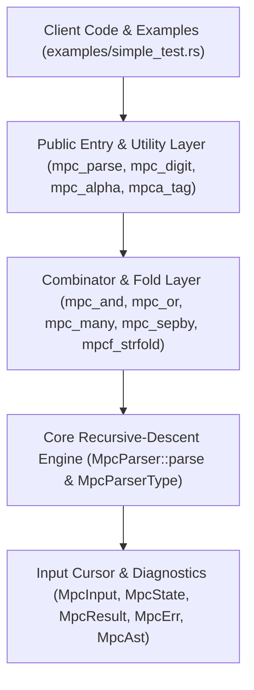
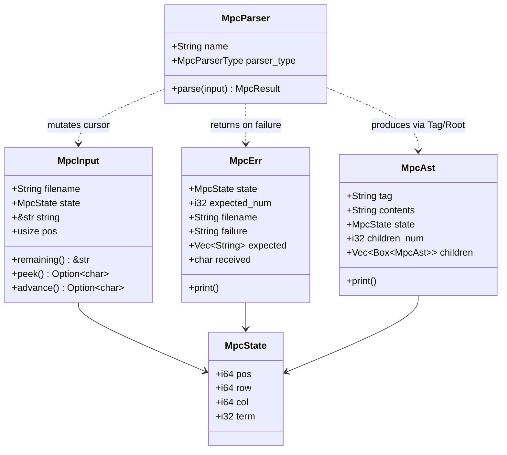
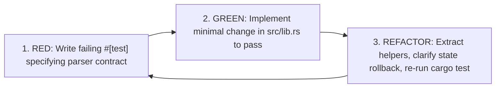

# SDLC, SDD, Agile Development, and TDD Guide for mpc-rs

This document defines the Software Development Life Cycle (SDLC), Software Design Document (SDD), Agile delivery framework, and Test-Driven Development (TDD) workflow for **mpc-rs** — a lightweight parser combinator library in Rust ported from Daniel Holden's C library [mpc](https://github.com/orangeduck/mpc).

For effort, schedule, and pricing projections (~0.78 KLOC; Basic COCOMO Organic estimate of 1.84 person-months over 3.14 months), see [COCOMO-cost-estimate.md](COCOMO-cost-estimate.md).

---

## 1. Software Development Life Cycle (SDLC)

**mpc-rs** follows an iterative, CI-verified SDLC suited to a compact systems-level Rust library (`Cargo` package `mpc`, edition `2021`). Each increment passes through six structured phases:


### Phase 1: Requirement Analysis
- **Functional Requirements:**
  - Provide primitive character and literal parsers (`mpc_any`, `mpc_char`, `mpc_range`, `mpc_oneof`, `mpc_noneof`, `mpc_satisfy`, `mpc_string`, `mpc_pass`, `mpc_fail`, `mpc_lift`, `mpc_lift_val`, `mpc_anchor`, `mpc_state`).
  - Provide composable combinators (`mpc_and`, `mpc_or`, `mpc_many`, `mpc_many1`, `mpc_count`, `mpc_sepby`, `mpc_sepby1`) and fold functions (`mpcf_strfold`, `mpcf_fst`, `mpcf_null`).
  - Provide character-class utilities (`mpc_whitespace`, `mpc_whitespaces`, `mpc_digit`, `mpc_digits`, `mpc_hexdigit`, `mpc_octdigit`, `mpc_alpha`, `mpc_alphanum`, `mpc_lower`, `mpc_upper`, `mpc_underscore`, boundary/input anchors).
  - Support AST node tagging (`mpca_tag`, `mpca_root`, `MpcAst`) and rich error reporting (`MpcErr`, `MpcState`).
  - Future parity with C `mpc`: higher-level token parsers (`int`, `hex`, `oct`, `number`, `real`, `float`, `char_lit`, `string_lit`, `regex_lit`, `ident`).
- **Non-Functional Requirements:**
  - **Memory safety:** Pure safe Rust with zero `unsafe` blocks.
  - **Zero runtime dependencies:** Self-contained single library crate (`src/lib.rs`) targeting Rust 1.70+ (2021 edition).
  - **Deterministic backtracking & termination:** Failed alternatives or partial separator matches must restore stream state, and repetition combinators must never enter infinite loops on zero-width parsers.
  - **UTF-8 correctness:** Advance byte offsets via `char::len_utf8()` while tracking logical character index, row, and column.

### Phase 2: System & Software Design
- Design decisions are captured in the **Software Design Document (Section 2)** below, modeling grammars as recursive `MpcParser` trees parameterized by `MpcParserType` variants and evaluated over a mutable `MpcInput<'a>` stream.

### Phase 3: Implementation
- Implemented cleanly in `src/lib.rs` with public constructor functions mirroring C `mpc` naming conventions (`mpc_*`, `mpcf_*`, `mpca_*`), alongside runnable smoke examples in `examples/simple_test.rs`.

### Phase 4: Testing & Quality Assurance
- **Debug Testing (Iterative):** Automated builds and unit tests run locally during TDD cycles via `cargo build` / `cargo test --verbose` (unoptimized `dev`/`test` profile with debug symbols and runtime overflow checks) and in GitHub Actions (`.github/workflows/rust.yml`) on every `push` and `pull_request` targeting `master`:
  - `cargo build --verbose`
  - `cargo test --verbose`
- **Final Release Testing:** Prior to tagging or publishing a release, the full suite and example targets are verified under compiler optimizations (`cargo build --release --verbose` and `cargo test --release --verbose`). See **Section 5** for the complete step-by-step debug and release procedures.
- New features and bug fixes follow the **TDD Red-Green-Refactor** workflow (Section 4).

### Phase 5: Deployment & Release
- Packaged via `Cargo.toml` (`mpc` v0.1.0, MIT license in `LICENSE`) with API documentation and quick-start examples in `README.md`.
- Final release artifacts are produced in `target/release/` after passing all release-mode tests, `cargo doc --no-deps`, and `cargo package --list` checks (Section 5.3).

### Phase 6: Maintenance & Evolution
- Tracked via focused single-purpose commits (for example, May 2026 parser backtracking fixes `b4d7be4` through `5d1027b`) and explicit `TODO` markers in `src/lib.rs` feeding back into the Agile backlog.

---

## 2. Software Design Document (SDD)

### 2.1 System Architecture

`mpc-rs` uses a layered, recursive-descent interpreter architecture where grammar definitions are declarative data structures (`MpcParser` wrapping `MpcParserType`) evaluated against an `MpcInput<'a>` cursor.



### 2.2 Data Structures & Type Specifications



| Type | Role | Key Fields / Variants |
|---|---|---|
| `MpcVal` | Type-erased semantic value | `Box<dyn std::any::Any>` |
| `MpcState` | Logical cursor location | `pos`, `row`, `col`, `term` |
| `MpcInput<'a>` | UTF-8 input slice and cursor | `filename`, `state`, `string`, byte offset `pos` |
| `MpcErr` | Diagnostic error payload | `state`, `expected_num`, `filename`, `failure`, `expected`, `received` |
| `MpcResult` | Parse outcome | `Ok(MpcVal)` \| `Err(MpcErr)` |
| `MpcParser` | Named parser node | `name`, `parser_type` |
| `MpcParserType` | Grammar AST / combinator enum | Primitives (`Any`, `Char`, `Range`, `OneOf`, `NoneOf`, `Satisfy`, `String`, `Pass`, `Fail`, `Lift`, `LiftVal`, `Anchor`, `State`), Combinators (`And`, `Or`, `Many`, `Many1`, `Count`, `SepBy`, `SepBy1`), AST (`Tag`, `Root`) |
| `MpcAst` | Syntax tree node | `tag`, `contents`, `state`, `children_num`, `children` |

### 2.3 Core Algorithms & State Invariants

1. **UTF-8 Safe Cursor Advancement (`MpcInput::peek` / `MpcInput::advance`):**
   - `remaining()` slices `&self.string[self.pos..]` using the current byte offset `self.pos`.
   - `peek()` inspects the next Unicode scalar value (`chars().next()`) without mutating state.
   - `advance()` advances byte offset by `c.len_utf8()`, increments logical `state.pos`, and updates line/column tracking (`row += 1; col = 0` on `'\n'`, otherwise `col += 1`).

2. **Backtracking Invariant (`saved_pos` / `saved_state`):**
   - **Invariant:** A parser that returns `MpcResult::Err` leaves `(input.pos, input.state)` unchanged when backtracking is required by callers or alternatives.
   - `MpcParserType::String` snapshots `(saved_pos, saved_state)` before iterating expected characters and restores both on mismatch or premature EOF.
   - `MpcParserType::Or` snapshots `(saved_pos, saved_state)` around each alternative, restoring before trying the next branch.
   - `MpcParserType::And` and `MpcParserType::Count` snapshot `(saved_pos, saved_state)` before executing the sequence/loop and restore both if any element fails.
   - `MpcParserType::SepBy` and `MpcParserType::SepBy1` snapshot `(saved_pos, saved_state)` before parsing `sep`; if `sep` succeeds but the subsequent item `parser` fails, both `input.pos` and `input.state` roll back so trailing separators are not orphaned.

3. **Zero-Width Infinite Loop Guard (`Many` / `Many1`):**
   - Repetition loops record `let before = input.pos;` before invoking the inner parser. If the inner parser succeeds without advancing (`input.pos == before`), the loop terminates immediately rather than spinning infinitely on zero-width parsers such as `mpc_pass()` or `mpc_lift()`.

4. **Error-State Separation & Anchor Evaluation (`Satisfy`, `NoneOf`, `Anchor`):**
   - `Satisfy` calls `input.peek()` and evaluates the predicate before calling `input.advance()`, ensuring failed predicates report the failing cursor position and do not consume the character.
   - `NoneOf` returns `MpcResult::Err` with `"unexpected end of input"` when `input.peek()` is `None`.
   - `Anchor` inspects `prev` (`'\0'` at `input.pos == 0`, otherwise `input.string[..input.pos].chars().next_back()`) and `next` (`input.peek().unwrap_or('\0')`), returning `MpcResult::Err` when `f(prev, next)` evaluates to `false`.

### 2.4 Design Refinements & Remaining Open Gaps

| Area | Location in `src/lib.rs` | Status | Current / Planned Behavior |
|---|---|---|---|
| **Anchors** | `MpcParserType::Anchor(f)` | Resolved (Sprint 4) | Evaluates `f(prev, next)` against previous/peeked UTF-8 chars (`'\0'` at boundaries) and returns `MpcErr` on mismatch |
| **Sequence Rollback** | `MpcParserType::And`, `Count` | Resolved (Sprint 4) | Snapshots `(saved_pos, saved_state)` on entry and restores both on element failure |
| **AST Construction** | `MpcParserType::Tag`, `Root` | Open (Sprint 6) | `Tag` formats debug string of `MpcVal`; `Root` passes value through — planned: recursive `MpcAst` node collection |
| **Error Formatting** | `MpcErr::print` | Open (Sprint 6) | Prints `Error: <failure>` only (`TODO`) — planned: format `filename`, 1-based `row + 1` / `col + 1`, `expected`, and `received` |

---

## 3. Agile Development Methodology

### 3.1 Agile Framework & Cadence

Aligning with the **Basic COCOMO Organic** profile in [COCOMO-cost-estimate.md](COCOMO-cost-estimate.md) (~1.84 PM effort, ~3.14 months duration, 1–2 contributors), development is organized into **2-week sprints** (6–7 sprints total) with continuous integration on `master`:

- **Sprint Planning:** Pull top-priority stories from the Product Backlog into a focused Sprint Backlog with testable acceptance criteria.
- **Daily / Async Checkpoints:** Small, atomic commits per logical fix or feature (demonstrated by commits `b4d7be4`–`5d1027b`), validated immediately by `cargo build` and `cargo test`.
- **Sprint Review & Demo:** Verify parser behavior against `examples/simple_test.rs` and unit test suites; update `README.md` API tables.
- **Sprint Retrospective:** Audit remaining `TODO`s, compiler warnings, and grammar edge cases (such as backtracking and EOF boundaries) to feed backlog refinement.

### 3.2 Sprint Roadmap

| Sprint | Status | Focus & Deliverables | Key Artifacts / Commits |
|---|---|---|---|
| **Sprint 1** | Done | Project bootstrap, core types, primitive parsers, license, README, GitHub Actions CI | `8e3881e`, `90f223b`, `0d68218`, `0f61ba5`, `0fcaf25` |
| **Sprint 2** | Done | Combinators, folds, utility parsers, and backtracking / zero-width / EOF fixes | `b4d7be4`, `768c404`, `9808616`, `4c623fc`, `668282c`, `d23c999`, `5d1027b` |
| **Sprint 3** | Done | COCOMO cost estimation, pricing assumptions, and SDLC/SDD/Agile/TDD engineering docs | `0bd572f`, `2636438`, `4c17b72`, `c2e24ba`, `SDLC-SDD-Agile-TDD.md` |
| **Sprint 4** | Done | Unit test suite (`#[cfg(test)]`), `Anchor` evaluation (`soi`/`eoi`/`boundary`), and `And`/`Count` rollback | `src/lib.rs` |
| **Sprint 5** | Next | Higher-level token & literal parsers (`int`, `hex`, `oct`, `number`, `real`, `float`, `char_lit`, `string_lit`, `regex_lit`, `ident`) | `src/lib.rs`, `README.md` |
| **Sprint 6** | Planned | Recursive `MpcAst` assembly, complete `MpcErr::print()`, benchmarks, and `v0.1.0` crate readiness | `src/lib.rs`, `examples/` |

### 3.3 Product Backlog

| ID | User Story | Priority | Points | Status | Acceptance Criteria |
|---|---|---|---:|---|---|
| **US-01** | As a grammar author, I need primitive char/string parsers with safe rollback. | High | 5 | Done | `Any`, `Char`, `Range`, `OneOf`, `NoneOf`, `Satisfy`, `String` handle EOF and restore state on partial match. |
| **US-02** | As a grammar author, I need sequence, choice, repetition, and separator combinators. | High | 8 | Done | `Or` backtracks, `Many`/`Many1` guard zero-width parsers, `SepBy`/`SepBy1` roll back trailing separators. |
| **US-03** | As a project maintainer, I need CI and cost/engineering docs. | Medium | 3 | Done | `.github/workflows/rust.yml`, `COCOMO-cost-estimate.md`, and `SDLC-SDD-Agile-TDD.md` are up to date. |
| **US-04** | As a developer, I need `mpc_soi`, `mpc_eoi`, and `mpc_boundary` to enforce input boundaries. | High | 5 | Done | `MpcParserType::Anchor` evaluates `f(prev, next)` and returns `MpcResult::Err` on mismatch. |
| **US-05** | As a grammar author, I need `mpc_and` and `mpc_count` to roll back on partial sequence failure. | High | 3 | Done | `input.pos` and `input.state` equal pre-call values whenever `And` or `Count` returns `Err`. |
| **US-06** | As a contributor, I need an automated `cargo test` unit test suite in `src/lib.rs`. | High | 5 | Done | 15 unit tests cover primitives, combinators, anchors, rollback, UTF-8 row/col tracking, and edge cases. |
| **US-07** | As a language builder, I need built-in numeric, literal, and identifier parsers (`mpc_int`, `mpc_ident`, etc.). | Medium | 8 | Backlog | Resolves line 715 `TODO` in `src/lib.rs` with unit tests for valid and malformed tokens. |
| **US-08** | As a parser user, I need full `MpcAst` trees and formatted `MpcErr::print()` diagnostics. | Medium | 8 | Backlog | `Tag`/`Root` build hierarchical `MpcAst` nodes; `MpcErr::print()` outputs file, line, column, expected, and received. |

### 3.4 Definition of Done (DoD)

A backlog item is **Done** only when:
1. Implementation compiles cleanly with zero warnings in both debug (`cargo build --verbose`) and release (`cargo build --release --verbose`) profiles.
2. Failing TDD test cases were written first (`Red`), pass after implementation (`Green`), and remain clean after refactoring (`Refactor`).
3. Both debug development tests (`cargo test --verbose`) and final release tests (`cargo test --release --verbose`) pass, and `.github/workflows/rust.yml` passes in CI.
4. All failure paths preserve the `(input.pos, input.state)` backtracking contract and handle multi-byte UTF-8 and EOF safely.
5. Public API changes are reflected in rustdoc comments and `README.md`.

---

## 4. Test-Driven Development (TDD)

### 4.1 Red-Green-Refactor Cycle

Every parser combinator enhancement or bug fix in `mpc-rs` follows the three-step TDD loop executed via `cargo test`:



1. **Red:** Add a focused `#[test]` in `src/lib.rs` (`#[cfg(test)] mod tests`) asserting both the `MpcResult` variant/value and the resulting `MpcInput` state (`pos`, `state.row`, `state.col`). Run `cargo test` and confirm the new test fails for the expected reason.
2. **Green:** Write the smallest safe implementation in `MpcParser::parse` or the combinator constructor to make the test suite pass.
3. **Refactor:** Remove duplicated state save/restore boilerplate, verify zero warnings (`cargo test`), and ensure all existing tests stay green.

### 4.2 Retroactive TDD Case Studies from `mpc-rs` Commit History

The May 2026 stabilization commits map directly to regression tests that belong in the permanent TDD suite:

| Commit | Target Parser | Failure Condition (Red) | Minimal Fix (Green) | Verification Assertion |
|---|---|---|---|---|
| `b4d7be4` | `Satisfy` | Failed predicate consumed the inspected char | Use `input.peek()` before `input.advance()` | `input.pos == 0` after `Satisfy` fails |
| `768c404` | `String` | Partial prefix match left cursor mid-string | Save `(saved_pos, saved_state)` and restore on mismatch/EOF | `mpc_string("abc")` on `"abd"` leaves `input.pos == 0` |
| `9808616` | `Or` | Failed first branch poisoned cursor for second branch | Save/restore `(saved_pos, saved_state)` per alternative | `mpc_or([mpc_string("ab"), mpc_string("ac")])` matches `"ac"` |
| `4c623fc` | `Many` / `Many1` | Zero-width inner parser looped infinitely | Break loop when `input.pos == before` | `mpc_many(mpc_pass(), mpcf_strfold)` terminates immediately |
| `668282c` | `SepBy` / `SepBy1` | Trailing separator consumed when item failed | Roll back `(saved_pos, saved_state)` before `sep` | `mpc_sepby(mpc_digits(), mpc_char(','), mpcf_strfold)` on `"1,2,"` leaves `","` unconsumed |
| `d23c999` | `NoneOf` | Returned success or misbehaved at EOF | Return `MpcResult::Err` when `input.peek()` is `None` | `mpc_noneof("ab")` on `""` returns `MpcResult::Err` |
| `5d1027b` | `mpc_boundary_newline` | Operator precedence ambiguity in boolean boundary check | Add explicit parentheses around `(!c.is_alphanumeric() && c != '_')` | Alphanumeric chars vs whitespace/punctuation classify consistently |

### 4.3 Rust TDD Unit Test Suite (`src/lib.rs`)

Sprint 4 integrated a 15-test `#[cfg(test)] mod tests` suite directly into `src/lib.rs` covering Sprint 2 regression fixes alongside `US-04` (`Anchor` evaluation) and `US-05` (`And`/`Count` transactional rollback). Representative Sprint 4 TDD tests include:

```rust
#[cfg(test)]
mod tests {
    use super::*;

    // --- Green Regression Tests (Existing Behavior) ---

    #[test]
    fn satisfy_failure_does_not_advance_input() {
        let parser = mpc_satisfy(|c| c.is_ascii_digit());
        let mut input = MpcInput::new("test", "abc");

        let res = parser.parse(&mut input);
        assert!(matches!(res, MpcResult::Err(_)));
        assert_eq!(input.pos, 0);
        assert_eq!(input.state.col, 0);
    }

    #[test]
    fn string_partial_match_backtracks() {
        let parser = mpc_string("hello");
        let mut input = MpcInput::new("test", "hel");

        let res = parser.parse(&mut input);
        assert!(matches!(res, MpcResult::Err(_)));
        assert_eq!(input.pos, 0);
        assert_eq!(input.remaining(), "hel");
    }

    #[test]
    fn noneof_fails_at_end_of_input() {
        let parser = mpc_noneof("abc");
        let res = mpc_parse("test", "", &parser);
        assert!(matches!(res, MpcResult::Err(_)));
    }

    #[test]
    fn or_backtracks_after_partial_branch_failure() {
        let parser = mpc_or(vec![mpc_string("abc"), mpc_string("abd")]);
        match mpc_parse("test", "abd", &parser) {
            MpcResult::Ok(val) => {
                assert_eq!(val.downcast_ref::<String>().map(String::as_str), Some("abd"));
            }
            MpcResult::Err(err) => panic!("expected 'abd' to match, got: {}", err.failure),
        }
    }

    #[test]
    fn many_stops_on_zero_width_parser() {
        let parser = mpc_many(mpc_pass(), mpcf_strfold);
        match mpc_parse("test", "abc", &parser) {
            MpcResult::Ok(val) => {
                assert_eq!(val.downcast_ref::<String>().map(String::as_str), Some(""));
            }
            MpcResult::Err(err) => panic!("expected mpc_pass repetition to terminate, got: {}", err.failure),
        }
    }

    #[test]
    fn sepby_backtracks_trailing_separator() {
        let parser = mpc_sepby(mpc_digits(), mpc_char(','), mpcf_strfold);
        let mut input = MpcInput::new("test", "12,34,");

        match parser.parse(&mut input) {
            MpcResult::Ok(val) => {
                assert_eq!(val.downcast_ref::<String>().map(String::as_str), Some("1234"));
                assert_eq!(input.remaining(), ",");
            }
            MpcResult::Err(err) => panic!("expected sepby match, got: {}", err.failure),
        }
    }

    #[test]
    fn utf8_input_tracks_row_and_col() {
        let parser = mpc_many(mpc_any(), mpcf_strfold);
        let mut input = MpcInput::new("test", "a\né");

        assert!(matches!(parser.parse(&mut input), MpcResult::Ok(_)));
        assert_eq!(input.state.pos, 3);
        assert_eq!(input.state.row, 1);
        assert_eq!(input.state.col, 1);
        assert_eq!(input.pos, "a\né".len());
    }

    // --- Sprint 4 (US-04 & US-05) Anchor & Transactional Rollback Tests ---

    #[test]
    fn eoi_anchor_matches_only_at_end_of_input() {
        let parser = mpc_and(vec![mpc_digits(), mpc_eoi()], mpcf_fst);
        assert!(matches!(mpc_parse("test", "123", &parser), MpcResult::Ok(_)));
        assert!(matches!(mpc_parse("test", "123abc", &parser), MpcResult::Err(_)));
    }

    #[test]
    fn and_restores_input_state_when_second_parser_fails() {
        let parser = mpc_and(vec![mpc_char('a'), mpc_char('b')], mpcf_strfold);
        let mut input = MpcInput::new("test", "ax");
        assert!(matches!(parser.parse(&mut input), MpcResult::Err(_)));
        assert_eq!(input.pos, 0);
    }
}
```

---

## 5. Build & Test Profiles: Debug vs. Final Release

`mpc-rs` separates **debug builds** (used during iterative TDD coding and troubleshooting) from **final release builds** (used for final acceptance testing, performance validation, and crate packaging).

### 5.1 Profile Comparison

| Aspect | Debug Build (`dev` / `test` Profile) | Final Release Build (`release` Profile) |
|---|---|---|
| **Purpose** | Iterative TDD cycles, step-through debugging, stack traces | Final pre-release validation, optimized execution, packaging |
| **Optimization (`opt-level`)** | `0` (unoptimized, fast incremental compile) | `3` (full compiler optimization) |
| **Debug Symbols (`debuginfo`)** | Included by default (`true`) | Stripped/omitted by default (`false`) |
| **Runtime Checks** | `debug_assert!` and integer overflow checks enabled | `debug_assert!` disabled; overflow checks off by default |
| **Output Directory** | `target/debug/` | `target/release/` |
| **Primary Commands** | `cargo build`, `cargo test --verbose`, `cargo run --example simple_test` | `cargo build --release`, `cargo test --release --verbose`, `cargo run --release --example simple_test` |

### 5.2 Debug Build Steps (Iterative Development & Testing)

Use the debug profile during Sprint work and TDD Red-Green-Refactor loops to get fast compilation, full symbols, and detailed failure diagnostics:

1. **Compile the library and examples in debug mode:**
   ```bash
   cargo build --verbose
   cargo build --examples --verbose
   ```
   Produces unoptimized binaries with debug symbols under `target/debug/`.

2. **Run the unit test suite in debug mode:**
   ```bash
   cargo test --verbose
   ```
   To run a single test while iterating in TDD:
   ```bash
   cargo test --verbose <test_name> -- --nocapture
   ```

3. **Capture full stack backtraces when diagnosing panics or parser failures:**
   - **PowerShell (Windows):**
     ```powershell
     $env:RUST_BACKTRACE=1
     cargo test --verbose -- --nocapture
     ```
   - **Bash / Linux / macOS:**
     ```bash
     RUST_BACKTRACE=1 cargo test --verbose -- --nocapture
     ```

4. **Run the debug smoke example:**
   ```bash
   cargo run --example simple_test
   ```

### 5.3 Final Release Build Steps (Final Testing & Release Verification)

Run the release profile before merging release milestones, tagging a version, or publishing `mpc` (`Cargo.toml` v0.1.0) to verify behavior under full optimization (`opt-level = 3`):

1. **Build the optimized release library and example binaries:**
   ```bash
   cargo build --release --verbose
   cargo build --release --examples --verbose
   ```
   Produces optimized artifacts under `target/release/`.

2. **Execute final testing against the release profile:**
   ```bash
   cargo test --release --verbose
   ```
   Running tests in `--release` mode ensures all assertions pass without relying on `debug_assert!` or unoptimized memory layout/timing.

3. **Run the example smoke test in release mode:**
   ```bash
   cargo run --release --example simple_test
   ```

4. **Verify documentation and crate packaging integrity:**
   ```bash
   cargo doc --no-deps
   cargo package --list
   ```
   Confirms rustdoc builds cleanly without broken links and inspects the exact file list included in the distributable `.crate` archive.

### 5.4 CI Pipeline Integration

Currently, [`.github/workflows/rust.yml`](.github/workflows/rust.yml) executes debug build and test verification on every `push` and `pull_request` to `master`:

```yaml
- name: Build
  run: cargo build --verbose
- name: Run tests
  run: cargo test --verbose
```

For final release gating (Sprint 6), extend the workflow or add a release-verification step so both profiles are validated automatically:

```yaml
- name: Final Release Build
  run: cargo build --release --verbose
- name: Final Release Tests
  run: cargo test --release --verbose
```
